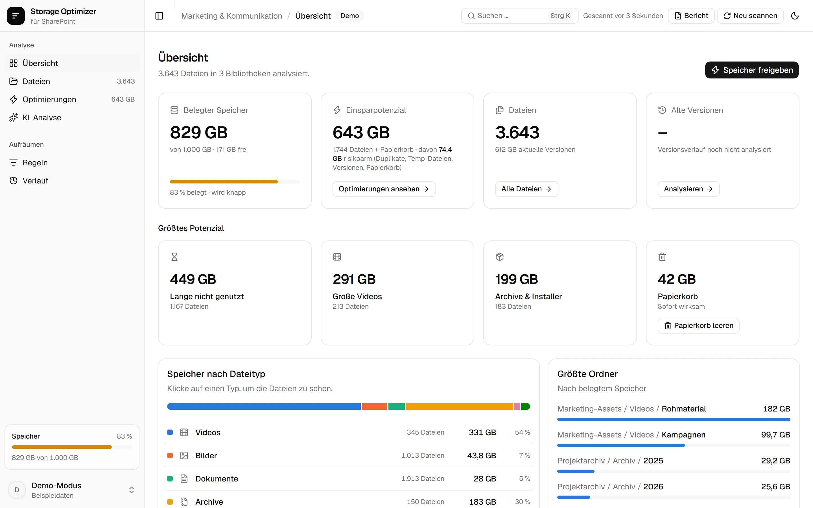
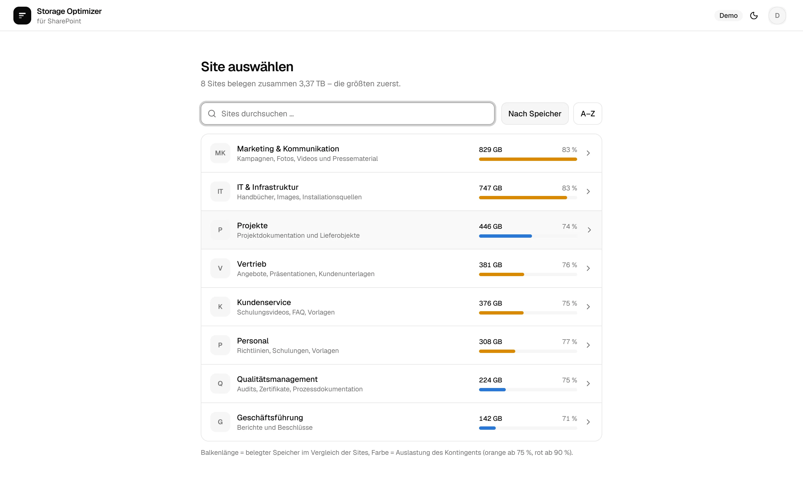
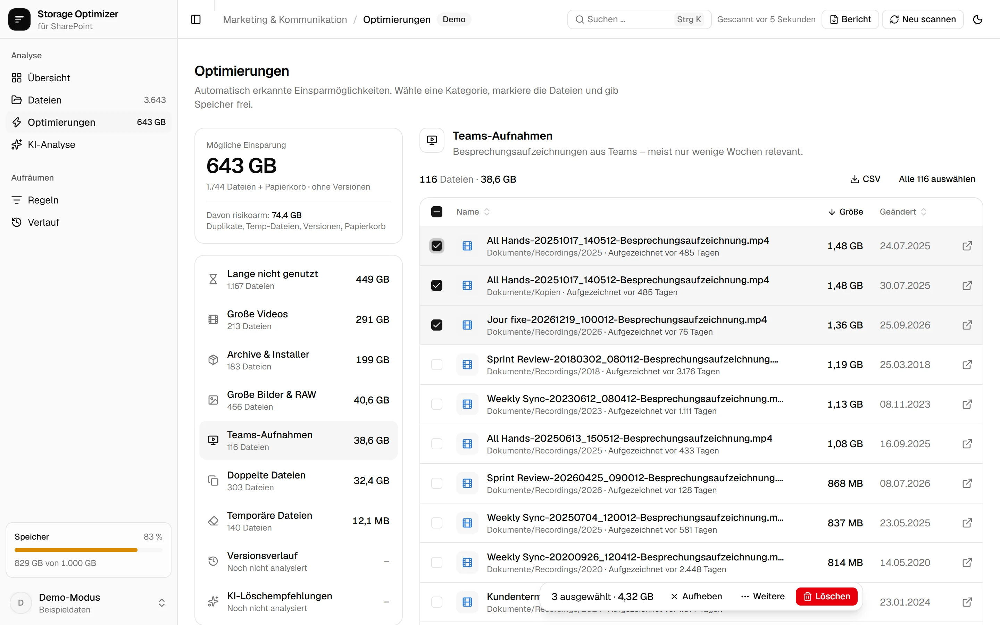
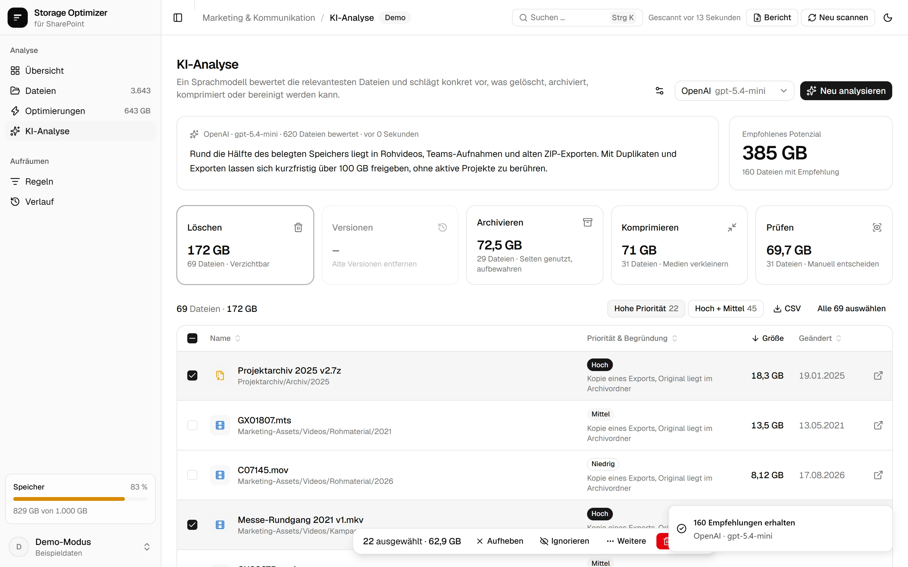
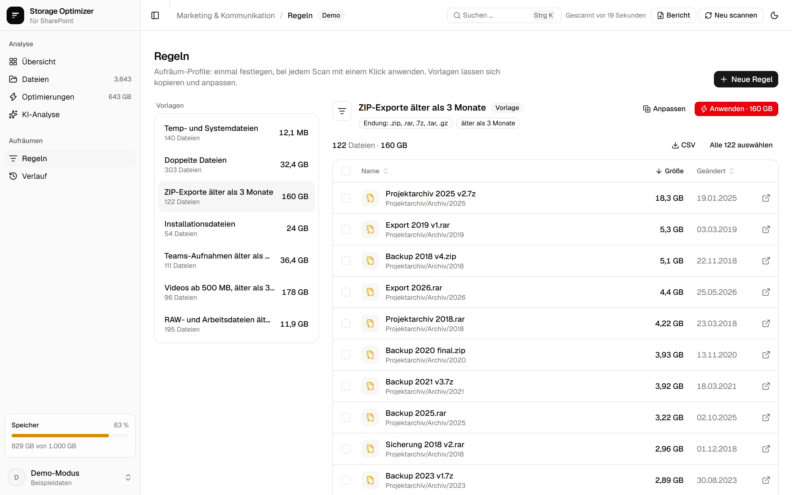
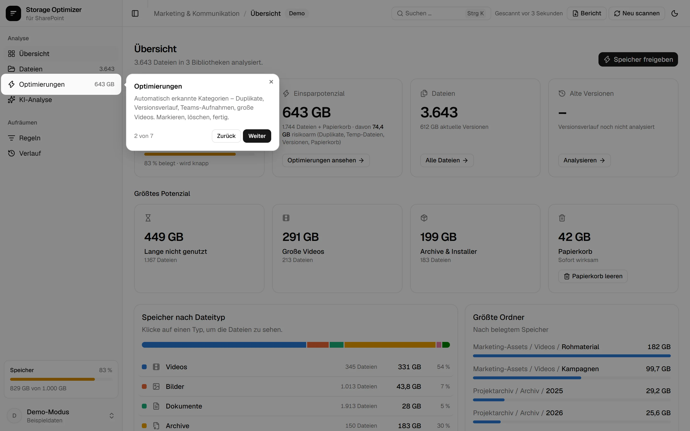

<div align="center">


# Storage Optimizer für SharePoint

**Finde in Minuten, was in SharePoint Speicher frisst – und gib ihn gezielt frei.**

Direkt über die Microsoft Graph API · mit KI-Empfehlungen von OpenAI oder Gemini · als Desktop-App, im Browser oder per Docker

[](https://nextjs.org)
[](https://react.dev)
[](https://www.typescriptlang.org)
[](https://www.electronjs.org)
[](https://tailwindcss.com)
[](https://learn.microsoft.com/graph/)

[Funktionen](#funktionen) · [Schnellstart](#schnellstart) · [Einrichtung](#einrichtung) · [Desktop-App](#desktop-app) · [Sicherheit](#sicherheit--datenschutz) · [Entwicklung](#entwicklung)

<br />

<picture>
  <source media="(prefers-color-scheme: dark)" srcset="docs/screenshots/overview-dark.webp" />
  
</picture>

</div>

## Funktionen

<table>
  <tr>
    <td width="50%" valign="top">
      
      <h4>Alle Sites im Überblick</h4>
      Speicher und Auslastung jeder Site auf einen Blick – die vollsten zuerst.
    </td>
    <td width="50%" valign="top">
      
      <h4>Automatische Optimierungen</h4>
      Duplikate, Versionsverlauf, Teams-Aufnahmen, große Videos, Altlasten, Archive, RAW-Bilder, Temp-Dateien und Papierkorb.
    </td>
  </tr>
  <tr>
    <td width="50%" valign="top">
      
      <h4>KI-Analyse</h4>
      OpenAI oder Gemini bewerten die ~700 relevantesten Dateien und schlagen pro Datei <i>Löschen, Versionen bereinigen, Archivieren, Komprimieren</i> oder <i>Prüfen</i> vor – mit Priorität und Begründung.
    </td>
    <td width="50%" valign="top">
      
      <h4>Regeln</h4>
      Aufräum-Profile wie „ZIP-Exporte älter als 3 Monate“ – Vorlagen oder eigene Regeln, mit einem Klick angewendet.
    </td>
  </tr>
</table>

**Analysieren**

- Vollständige Inventur jeder Bibliothek per Delta-Query – Speicher nach Dateityp, größte Ordner, Datenalter, größte Dateien
- Einsparpotenzial mit risikoarmem Anteil, Speicherverlauf als Trenddiagramm
- Dateiliste mit Filtern nach Typ, Größe, Alter, Bibliothek und Suche; Befehlspalette mit <kbd>Strg</kbd>+<kbd>K</kbd>

**Aufräumen**

- Mehrfachauswahl über Seiten hinweg (Shift-Klick für Bereiche), Löschen in den Papierkorb oder endgültig
- Alte Versionen löschen und **Versionslimits je Bibliothek** setzen, damit der Speicher nicht wieder wächst
- **Besitzer benachrichtigen** – eine Mail pro Person mit ihren großen Dateien, Links und Frist
- **PDF-Bericht** mit Kennzahlen, Trend, Einsparmöglichkeiten und Maßnahmen; CSV-Export jeder Liste

**Absichern**

- **Verlauf & Rückgängig** – jede Aktion wird protokolliert, Löschungen lassen sich direkt aus der Meldung oder später wiederherstellen
- Einstiegstour beim ersten Start, Demo-Modus mit Beispieldaten ohne jede Einrichtung

**Nur in der Desktop-App**

- **Lokal sichern & löschen** – auf eine externe Platte oder ein NAS, mit Ordnerstruktur und Größenprüfung
- **Medien komprimieren** – Videos (H.264) und Bilder ersetzen die Originale in SharePoint, gleicher Name, gleiche Links
- **Hintergrund-Prüfung** im Infobereich mit Benachrichtigung, wenn eine Site voll wird; automatische Updates

## Schnellstart

| | |
| --- | --- |
| **Desktop** | Installer aus den [Releases](../../releases/latest) laden und starten. |
| **Docker** | `docker run -p 3000:3000 ghcr.io/<owner>/<repo>:latest` |
| **Entwicklung** | `npm install && npm run dev` → <http://localhost:3000> |

Danach **Demo ansehen** oder **Microsoft 365 verbinden** – die Einrichtung passiert vollständig in der App, eine `.env`-Datei ist nicht nötig.

<p align="center">
  
</p>

## Einrichtung

### Microsoft 365 verbinden

Die App braucht eine eigene App-Registrierung in Microsoft Entra ID (einmalig, ca. 3 Minuten). Der Dialog
**Einstellungen → Microsoft 365** zeigt die passende Umleitungs-URI zum Kopieren und führt durch die Schritte:

1. [Entra Admin Center](https://entra.microsoft.com) → **App-Registrierungen** → **Neue Registrierung**
2. Plattform **Single-Page-Anwendung** mit der Umleitungs-URI aus dem Dialog hinzufügen
3. Delegierte Berechtigungen ergänzen (siehe unten)
4. Anwendungs-ID und Verzeichnis-ID im Dialog eintragen

| Variante | Umleitungs-URI |
| --- | --- |
| Desktop-App | `http://localhost:41731/auth/redirect` |
| Entwicklung | `http://localhost:3000/auth/redirect` |
| Server / Docker | `https://<host>/auth/redirect` |

> [!TIP]
> Eine App-Registrierung kann mehrere Umleitungs-URIs haben – einmal anlegen, für alle Varianten nutzen.

<details>
<summary><b>Berechtigungen</b> (alle delegiert)</summary>

| API | Berechtigung | Wofür |
| --- | --- | --- |
| Microsoft Graph | `User.Read` | Anmeldung |
| Microsoft Graph | `Sites.Read.All` | Sites und Bibliotheken auflisten, Dateien scannen |
| Microsoft Graph | `Files.ReadWrite.All` | Dateien löschen, komprimierte Fassungen hochladen |
| SharePoint | `AllSites.Manage` | *optional:* Versionen bereinigen, Versionslimits, Papierkorb, Wiederherstellen |
| Microsoft Graph | `Mail.Send` | *optional:* Besitzer benachrichtigen – wird erst beim ersten Versand angefragt |

Keine davon erfordert zwingend Admin-Zustimmung; je nach Tenant-Richtlinie kann sie nötig sein. Für das Leeren des
endgültigen Papierkorbs (Stufe 2) sind Websitesammlungs-Adminrechte erforderlich.

</details>

### KI verbinden (optional)

Unter **Einstellungen → KI-Anbieter** einen Schlüssel für [OpenAI](https://platform.openai.com/api-keys) und/oder
[Google Gemini](https://aistudio.google.com/apikey) eintragen, mit **Prüfen** testen und optional ein anderes Modell wählen
(Standard: `gpt-5.4-mini` bzw. `gemini-3.8-flash`). Sind beide hinterlegt, lässt sich der Anbieter pro Analyse wechseln.

<details>
<summary><b>Vorgaben für einen gemeinsamen Server</b> (optional, z. B. Docker)</summary>

Administratoren können Werte für alle Nutzer vorbelegen. Eingaben in der App haben Vorrang, Server-Schlüssel verlassen den Server nie.

| Variable | Bedeutung |
| --- | --- |
| `AZURE_CLIENT_ID`, `AZURE_TENANT_ID` | App-Registrierung vorbelegen |
| `OPENAI_API_KEY`, `OPENAI_MODEL` | OpenAI für alle Nutzer bereitstellen |
| `GEMINI_API_KEY`, `GEMINI_MODEL` | Gemini für alle Nutzer bereitstellen |
| `AI_PROVIDER` | bevorzugter Anbieter (`openai` \| `gemini`) |

</details>

## Desktop-App

Ein schlanker Electron-Rahmen um dieselbe Web-App: Der Next.js-Server läuft intern auf `localhost:41731`, die Anmeldung
öffnet sich im App-Fenster, alle anderen Links im Standardbrowser.

| Plattform | Download | Ohne Code-Signatur |
| --- | --- | --- |
| Windows 10/11 | `SharePoint-Storage-Optimizer-Setup-<version>.exe` | SmartScreen: *Weitere Informationen → Trotzdem ausführen* |
| macOS (Apple Silicon) | `SharePoint-Storage-Optimizer-<version>-arm64.dmg` | Rechtsklick → *Öffnen* |
| macOS (Intel) | `SharePoint-Storage-Optimizer-<version>-x64.dmg` | Rechtsklick → *Öffnen* |

> [!NOTE]
> **Videos komprimieren** braucht ffmpeg, das aus Lizenzgründen nicht mitgeliefert wird:
> `winget install Gyan.FFmpeg` bzw. `brew install ffmpeg`. Die App findet es automatisch; sonst lässt sich der Pfad unter
> *Einstellungen → Desktop* eintragen. Bilder werden ohne Zusatzsoftware komprimiert.

<details>
<summary><b>Updates</b></summary>

Builds aus GitHub Actions suchen beim Start und alle 6 Stunden nach einer neuen Version. Windows lädt und installiert sie
selbst. macOS-Builds ohne Apple-Zertifikat verweisen auf die Download-Seite – automatische Updates erlaubt macOS nur
signierten Apps. Voraussetzung sind öffentlich abrufbare Releases; bei einem privaten Repository beim Build
`DESKTOP_UPDATE_URL` auf einen eigenen Webserver mit den Release-Dateien setzen.

</details>

<details>
<summary><b>Signieren und notarisieren</b></summary>

Ohne Zertifikate sind Windows-Builds unsigniert und macOS-Builds ad hoc signiert – sie laufen, zeigen aber die Warnungen
oben. Mit diesen Repository-Secrets signiert der Workflow automatisch:

| Secret | Inhalt |
| --- | --- |
| `WIN_CERTIFICATE`, `WIN_CERTIFICATE_PASSWORD` | Code-Signing-Zertifikat (`.pfx`, base64) und Passwort |
| `MAC_CERTIFICATE`, `MAC_CERTIFICATE_PASSWORD` | „Developer ID Application“-Zertifikat (`.p12`, base64) und Passwort |
| `APPLE_ID`, `APPLE_APP_SPECIFIC_PASSWORD`, `APPLE_TEAM_ID` | Notarisierung durch Apple |

</details>

## Sicherheit & Datenschutz

- **Eigene Berechtigungen** – die App arbeitet mit den delegierten Rechten des angemeldeten Benutzers
- **Umkehrbar** – Löschen landet standardmäßig im Papierkorb; jede Aktion steht im Verlauf
- **Nur Metadaten an die KI** – Pfad, Name, Größe und Datum, niemals Dateiinhalte
- **Schlüssel bleiben lokal** – in der Desktop-App verschlüsselt über den Schlüsselspeicher des Betriebssystems
  (Electron `safeStorage`), im Browser im `localStorage`; für eine Analyse gehen sie einmalig über den App-Server an den Anbieter
- **Abgesicherte Desktop-App** – Sandbox, Context Isolation, Electron-Fuses, Navigationsschutz; Sicherungen schreiben nur in
  vom Nutzer gewählte Ordner, Downloads und Uploads nur von bzw. zu SharePoint

> [!IMPORTANT]
> Gelöschte Dateien belegen bis zu 93 Tage weiter das Kontingent. Für sofortige Wirkung **Endgültig löschen** wählen oder
> anschließend den Papierkorb leeren. Beim Bereinigen von Versionen bleibt die aktuelle Version immer erhalten.

## Architektur

```mermaid
flowchart LR
  subgraph client["Browser oder Desktop-App"]
    ui["Oberfläche<br/>Next.js · React · shadcn/ui"]
    main["Electron-Hauptprozess<br/>Sicherung · ffmpeg · Updates"]
  end
  subgraph server["Next.js-Server<br/>lokal oder Docker"]
    proxy["/api/sharepoint"]
    ai["/api/ai/*"]
  end
  ui -- "MSAL-Token" --> graph["Microsoft Graph"]
  ui --> proxy -- "Versionen, Papierkorb" --> sp["SharePoint REST"]
  ui --> ai -- "nur Metadaten" --> llm["OpenAI · Gemini"]
  main -. IPC .- ui
```

## Entwicklung

| Befehl | |
| --- | --- |
| `npm run dev` | Entwicklungsserver auf Port 3000 |
| `npm run check` | Lint, Typecheck (TS 7), Unit- und Komponententests |
| `npm run build && npm run test:e2e` | End-to-End im Browser (Playwright, Demo-Modus) |
| `npm run desktop:build && npm run test:desktop` | End-to-End der echten Electron-App |
| `npm run desktop:dist` | Installer für das aktuelle Betriebssystem nach `dist-desktop/release/` |

Lokal ohne heruntergeladenes Chromium nutzt `PW_CHANNEL=msedge npm run test:e2e` das installierte Edge. Die Tests fangen
die KI-Aufrufe ab – echte API-Schlüssel sind nicht nötig.

### CI/CD

| Workflow | Auslöser | Inhalt |
| --- | --- | --- |
| `ci.yml` | Push auf `main`, Pull Requests | Lint, Typecheck, Tests mit Coverage, Produktions-Build, Playwright-E2E |
| `desktop.yml` | Tags `v*`, Pull Requests mit Desktop-Änderungen, manuell | `.exe` und `.dmg` (arm64 + x64), Desktop-Tests, Smoke-Test der gepackten App, Release inkl. Update-Feed |
| `release.yml` | grüner CI-Lauf auf `main`, Tags `v*` | Docker-Image nach `ghcr.io/<owner>/<repo>` |
| `dependabot.yml` | wöchentlich | npm-Pakete und Actions aktuell halten |

Release erstellen: `git tag v1.0.0 && git push --tags` – die Versionsnummer der Installer kommt aus dem Tag.

<details>
<summary><b>Technik</b></summary>

| Bereich | Eingesetzt |
| --- | --- |
| Framework | Next.js 16 (App Router, Turbopack, Cache Components, Standalone-Output), React 19 |
| Desktop | Electron 45 (Utility Process, Sandbox, `safeStorage`, Fuses), electron-builder 26, electron-updater, esbuild |
| Sprache | TypeScript 7 (`tsc`), `@typescript/typescript6` als API für ESLint |
| UI | Tailwind CSS 4, shadcn/ui (Radix), cmdk, lucide-react, sonner, next-themes, driver.js (Einstiegstour) |
| Daten | Microsoft Graph Client (Delta-Query, JSON-Batching, Retry bei Drosselung), SharePoint REST über Proxy |
| KI | OpenAI SDK v7 (Responses API), Google Gen AI SDK v3, gemeinsames Zod-4-Schema |
| Diagramme & Bericht | Recharts 3 über shadcn Charts, @react-pdf/renderer |
| Medien | ffmpeg (Videos), sharp (Bilder) |
| State | Zustand, idb-keyval, Papa Parse |
| Tests | Vitest 5 + Testing Library, Playwright (Browser und Electron) |

</details>

<details>
<summary><b>Projektstruktur</b></summary>

```
src/
  app/            Layout, Seite, Login-Redirect, API-Routen (ai, sharepoint, config)
  components/     App-Shell, Ansichten (views/), Dialoge, Einstiegstour, Einstellungen, Diagramme
  lib/            Graph-Anbindung, Demo-Daten, Analyse, Regeln, Verlauf, Trend, Aktionen, Store
  lib/report/     PDF-Bericht
  lib/server/     KI-Anbieter und Prompt – nur serverseitig
desktop/          Electron-Hauptprozess, Preload, Sicherung, Medien, Hintergrund, Updates, Packaging
scripts/          Desktop-Staging, Smoke-Test, Standalone-Start
e2e/, e2e-desktop/  Playwright-Tests für Browser und Electron
docs/screenshots/ Bilder für diese README
```

</details>
